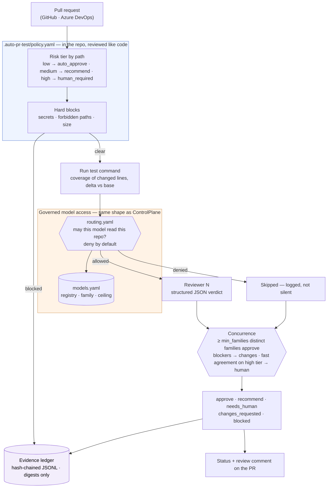

# auto-pr-test

[](https://github.com/Lanier-Developments/auto-pr-test/actions/workflows/auto-pr-test.yml)
[](LICENSE)
[](pyproject.toml)

A policy-as-code pull-request gate for the AI Development Life Cycle (ADLC).

Every merge should be able to prove three things afterwards: the tests ran and coverage of the *changed lines* is known; reviewers from more than one model family independently agreed, under a routing policy that says which models were allowed to read the code; and the record of all that has not been altered since.

Most "AI code review" tools post a comment. This one is a **gate**: a lifecycle control with a policy file, a concurrence rule, and an evidence ledger.

## How it works



Order is deliberate. Policy and hard blocks run before any model sees the code — there is no point paying three reviewers to look at a PR that ships a private key. Tests run before review so each reviewer is told which changed lines never executed. Routing runs before each reviewer so a refused model is recorded, not skipped. Concurrence runs last.

## Principles

- **Two sizes of the same model are one opinion.** Approval needs `min_families` *distinct* model families. A Claude agreeing with a Claude is not independent review.
- **Fast agreement is a flag, not a pass.** Unanimous approval with zero findings on a high-risk tier is recorded as a warning and sent to a human. Independent reviewers finding nothing wrong with risky code is itself a finding.
- **Fail closed.** No routing rule matches → deny. Model errored → non-approval. Review unparseable → non-approval. Nothing becomes a yes by accident.
- **The diff is data, not instructions.** It is fenced, and the instruction boundary is restated after it. A PR is text written by whoever opened it.
- **Digests, not text.** The ledger stores SHA-256 of the diff and of every review, never the content. A file that lives forever in the repo must not become a copy of the code or of commentary on it.
- **Governance is provider-agnostic.** GitHub today, Azure DevOps behind the same five-method protocol; Bedrock, Gemini and Ollama behind one `complete()` choke point. Adding either is a registry entry plus an adapter.

## Quick start

```bash
pip install "auto-pr-test[all]"        # or [bedrock], [gemini]; Ollama needs nothing extra
cp -r <this repo>/.auto-pr-test .auto-pr-test       # starter policy — edit the tiers for your repo
auto-pr-test policy-check              # can min_families ever be met for this classification?
```

Run it on a local diff, posting nothing:

```bash
git diff origin/main...HEAD > pr.diff
auto-pr-test review --diff-file pr.diff --title "my change" --dry-run
auto-pr-test verify                    # walk the ledger chain
```

Demo with no credentials at all (two fake reviewer families):

```bash
auto-pr-test --models policy/models.demo.yaml review --diff-file pr.diff --dry-run
```

### As a GitHub Action

```yaml
# .github/workflows/auto-pr-test.yml
on: pull_request
permissions: { contents: read, pull-requests: write, statuses: write }
jobs:
  gate:
    runs-on: ubuntu-latest
    steps:
      - uses: actions/checkout@v4
      - uses: Lanier-Developments/auto-pr-test@main
        env:
          AWS_ACCESS_KEY_ID: ${{ secrets.AWS_ACCESS_KEY_ID }}
          AWS_SECRET_ACCESS_KEY: ${{ secrets.AWS_SECRET_ACCESS_KEY }}
          AWS_REGION: us-east-1
          GEMINI_API_KEY: ${{ secrets.GEMINI_API_KEY }}
```

The step exits 0 only for `approve` and `recommend`; everything else fails the check. The decision, the rendered review and the ledger line are uploaded as the `auto-pr-test-evidence` artifact.

## The policy file

`.auto-pr-test/policy.yaml` lives in the repository it governs and is in the `high` tier of its own default policy, so changing who may approve what is a pull request that goes through the gate.

| Key | What it decides |
|---|---|
| `classification` | How sensitive the source is. `routing.yaml` decides which models may read it; a `confidential` repo gets only self-hosted reviewers. |
| `reviewers`, `min_families` | Which registry models review, and how many distinct families must approve. |
| `tiers.*.paths`, `default_tier` | Risk by path glob. A PR takes the highest tier of any file it touches. |
| `tiers.*.action` | `auto_approve` · `recommend` (human merges) · `human_required` (gate never recommends). |
| `fast_agreement_tiers` | Tiers where unanimous zero-finding approval is treated as unreviewed. |
| `testing` | Test command, coverage report, floor on the coverage delta, whether to ask reviewers for tests covering uncovered changed lines. |
| `blocks` | Secret scan, size cap, forbidden paths. Any hit blocks before review. |
| `ledger` | Where the chain lives. |

`policy/models.yaml` and `policy/routing.yaml` use the same format as [ControlPlane](https://github.com/Lanier-Developments/ControlPlane), so an organisation already governing model access there can point the gate at the registry it has.

## Outcomes

| Outcome | Meaning | CI exit |
|---|---|---|
| `approve` | Concurrence reached on an `auto_approve` tier; the gate approves the PR | 0 |
| `recommend` | Concurrence reached on a `recommend` tier; a human merges | 0 |
| `needs_human` | Too few families approved, a reviewer failed, or fast agreement on a high tier | 1 |
| `changes_requested` | Tests failed, coverage fell below the floor, or any reviewer found a blocker | 1 |
| `blocked` | Hard block: secret, forbidden path, oversize | 1 |

## Verifying a decision later

Every ledger entry carries the policy's SHA-256, the diff's SHA-256, the routing decision for every reviewer (allowed or refused, with the rule id), each review's digest, token counts and cost, and the outcome with its reasons. `auto-pr-test verify` walks the chain. Anyone holding the PR can re-hash the diff and confirm it is the one that was judged.

Tamper-evident, not tamper-proof: someone who can rewrite the whole file in order can forge a consistent chain. The claim is that quiet edits are detectable, and nothing more.

## Status

Proof of concept, under active development.

| | |
|---|---|
| Policy, tiers, hard blocks, secret scan | done |
| Test runner with coverage-of-change and delta | done (pytest-cov JSON; other formats are a small adapter) |
| Registry + routing, deny by default | done |
| Reviewers: Bedrock, Gemini, Ollama, fake | done |
| Concurrence with family rule and fast-agreement flag | done |
| Hash-chained ledger + verify | done |
| GitHub provider + composite Action | done |
| Azure DevOps provider | read side done; votes and PR statuses stubbed with the exact endpoints noted |
| Ledger persistence across runs | the Action uploads the ledger as an artifact; committing it back on merge is next |
| Base-branch coverage for the delta | passed in by hand (`--base-coverage`); fetching it from the last main run is next |
| Suggested tests opened as a companion commit | reviewers return them; the gate posts them, does not push them |

## Development

```bash
pip install -e ".[dev]"
python -m pytest --cov=auto_pr_test --cov-report=term-missing
auto-pr-test policy-check && auto-pr-test verify
```

The gate gates itself: `.github/workflows/auto-pr-test.yml` runs the deterministic checks on every PR and the live review when the `AUTO_PR_TEST_LIVE` repository variable is `true`.

## License

MIT — Lanier Developments LLC.
